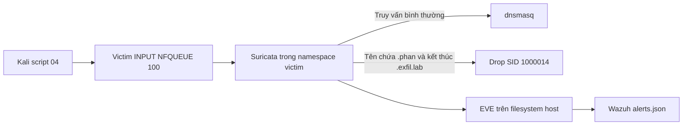

# Bật và phục hồi IPS cho bài DNS trong lab

Đây là demo chặn thật cho script `04_dns_tunnel_sim.sh` có sẵn, không phải cấu hình IPS cho toàn doanh nghiệp. Mặc định lab vẫn ở IDS. Xem [kết quả trước sau và rollback](../docs/results/ips-dns-drop-2026-11-13.md).

## Đường đi và phạm vi

Trong chế độ demo, Suricata của host chạy trong **network namespace của victim** qua `nsenter -n`; filesystem vẫn là host. Chỉ hai rule INPUT/OUTPUT trong namespace victim đưa UDP DNS giữa `.20` và `.10` qua NFQUEUE 100. Không sửa firewall host, IP, route, Docker bridge hoặc card nghiên cứu. EVE vẫn ghi `/var/log/suricata/eve.json`, Wazuh đọc theo cấu hình cũ.



Rule bổ sung chỉ khớp marker của bài giả lập, không thay năm rule IDS gốc. Không đổi rule rate-based DNS 1000004 thành drop: threshold điều khiển tần suất alert, không phải một ngưỡng đảm bảo gói trước đó được cho qua. Rule mới không dùng threshold và bị giới hạn chặt vào lab.

## Chuẩn bị và thao tác

Chỉ dùng trên Ubuntu host của lab được phép, có Suricata 7.0.3 hỗ trợ NFQ, victim `.10` đang healthy và luồng EVE → Wazuh đã hoạt động. Helper cần quyền Docker quản trị, PID namespace host để nói chuyện với systemd, NET_ADMIN **trong namespace victim**, và các bind mount được liệt kê trong script. Đây là công cụ quản trị có đặc quyền, không chạy trên máy thật ngoài phạm vi lab.

```bash
# Từ gốc repo BTL; build chỉ cài công cụ, chưa bật chặn.
docker build -f lab/Dockerfile.ips-tools -t csattt-ips-tools:local lab
export LAB_STATE_DIR="$HOME/lab"
# Lần đầu, chụp IDS rules, effective service config, firewall victim và hash ngoài Git.
bash scripts/ips_mode.sh init
bash scripts/ips_mode.sh status
# Rulecheck -T phải pass trước khi service đổi sang NFQUEUE.
bash scripts/ips_mode.sh enable
# Chạy script cũ trong Kali; timeout ở truy vấn đầu là hành vi dự kiến khi chặn.
docker exec kali bash /root/scripts/04_dns_tunnel_sim.sh
# Xóa đúng các hook và override do demo tạo, trở lại IDS gốc.
bash scripts/ips_mode.sh ids
bash scripts/ips_mode.sh status
```

`init` từ chối ghi đè snapshot đã có; giữ state và backup ngoài repo. Không recreate hoặc dừng victim khi đang bật IPS; PID được đối chiếu với snapshot trước enable. Thư mục `ips-state` thuộc riêng lượt lab này. Nếu chuyển máy/VM hoặc PID victim đổi, trở về IDS và rà snapshot trước khi khởi tạo lượt khác; không tự xóa state để vượt kiểm tra.

`enable` tạo rule file riêng và override riêng của Suricata, dùng one-shot unit chỉ để chạy `suricata -T`, rồi xóa unit kiểm tra. Nếu enable lỗi, công cụ thử phục hồi IDS và trả exit code lỗi. `ids` bỏ đúng các hook có comment `CSATTT_IPS_DNS`, xác minh file thuộc demo trước xóa, bỏ override và khởi động unit IDS gốc. Không dùng `iptables -F` hoặc khôi phục mù toàn firewall.

`--queue-bypass` là **fail-open**: nếu không có listener, kernel cho lưu lượng đi qua. Vì vậy không được lấy timeout đơn thuần làm bằng chứng IPS. Phải có listener, verdict drop, EVE/Wazuh action blocked và đối chứng dịch vụ bình thường. Trong thời gian demo, chỉ DNS đã queue được kiểm tra bởi engine; đây không thay thế chế độ IDS nghe toàn br-lab. Kết thúc luôn chuyển lại IDS.

## Cách đo

Chốt đơn vị là một lần gọi script, kèm số query/response trong pcap. Dùng script 04 nguyên trạng cho IDS trước, IPS, IDS phục hồi; PCAP_DIR khác nhau cho từng pha. NXDOMAIN của DNS giả vẫn là phản hồi thành công. Khi IPS chặn, `dig +time=1 +tries=1` timeout và `set -e` khiến script dừng sớm; exit 9 được ghi là prevention dự kiến, không gọi là hoàn tất 40 truy vấn.

Chạy `tests/normal_traffic.sh` trước/sau lượt drop trong IPS để kiểm ping, HTTP, SSH hợp lệ và ba DNS không có marker `.phan`. Giữ log gốc, lấy offset trước mỗi pha, đối chiếu timestamp/action ở EVE và Wazuh. Kiểm bộ đếm queue để loại trừ tràn queue, và số verdict accepted/dropped lúc dừng engine. Capture toàn br-lab riêng để kiểm lưu lượng ngoài subnet trong khoảng đo.

Rollback so sánh luật/chính sách firewall; bỏ qua counter động và khung filter rỗng với mọi built-in policy ACCEPT. Test hồi quy phải giữ khác biệt DROP policy, queue hook còn sót, user chain và thứ tự rule. IP/route, network ID, cấu hình Wazuh/sensor/rule gốc và unit Suricata được so với backup độc lập.

## Nguồn đã đọc ngày 13 tháng 11 năm 2026

- [Suricata 7.0.3 mục 15.1](https://docs.suricata.io/en/suricata-7.0.3/setting-up-ipsinline-for-linux.html): NFQUEUE dùng `-q`; chỉ queue lưu lượng đã chọn; bypass cho qua khi thiếu listener. Chỉ áp dụng ở namespace victim, không dùng ví dụ flush toàn firewall trong tài liệu.
- [Suricata 7.0.3 mục 8.37](https://docs.suricata.io/en/suricata-7.0.3/rules/thresholding.html): threshold giới hạn alert; drop/reject vẫn có thể áp mỗi packet. Không suy ngưỡng alert thành ngưỡng cho phép gói.

Tài liệu là căn cứ cấu hình. Kết quả chặn/rollback riêng được chứng minh bằng bằng chứng thực nghiệm, không suy từ tài liệu hay từ việc parse rule thành công.
